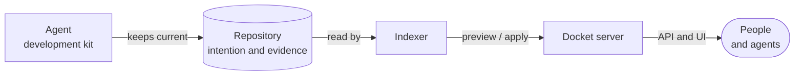

# docket

<a href="https://readme.exalynt.com/how-it-works/stability-levels#stability-prototype"><picture>
  <source media="(prefers-color-scheme: dark)" srcset="https://design.exalynt.io/stability/prototype-extra-long-dark.svg">
  
</picture></a>

What your software is meant to do, written beside the code, linked to the
evidence of what it actually does, and readable by everyone with a stake in it.

> [!WARNING]
> Docket is a **Prototype**, one of Exalynt's [stability levels](https://readme.exalynt.com/how-it-works/stability-levels). It explores an idea so we can choose a direction. Anything here, the spec included, may change completely or be thrown away. Don't build on it yet.

Docket is an open format, and the tools that read it, for writing down what
your software is meant to do: its capabilities, the rules they follow, the
people they serve, how stable each one is, and the gaps we know about. Each is
a small plain-language doc in the repository, changed in the same commit as the
code. Code and tests point back at them as evidence. Tools then show everyone,
technical or not, what's intended, what's real, and the gap between.

**Contents:** [The problem](#the-problem) · [How it works](#how-it-works) · [Who it's for](#who-its-for) · [How it supports software engineering](#how-it-supports-software-engineering) · [What Docket isn't](#what-docket-isnt) · [Does it belong in Docket?](#does-it-belong-in-docket) · [Proposed architecture](#proposed-architecture) · [Where it is today](#where-it-is-today) · [Open questions](#open-questions) · [Layout](#layout)

## The problem

Docket exists to help people apply the discipline of software engineering to
their projects, with
[craft and judgment](https://readme.exalynt.com/how-it-works/software-engineering).
Judgment is only as sound as the evidence it rests on, and for most projects
that evidence is hard to find:

- **Code shows what the software does, not what it should do.** A bug looks
  just like a deliberate choice. A missing rule leaves nothing behind to read.
  A capability that's half built looks finished. An agent that reads the code
  can only guess at intention from behavior, and ends up explaining the bugs as
  if they were meant.
- **Intention isn't written down anywhere you can trust.** What the software
  must and must never do, what a word means to the business, and which rules
  must always hold live in people's heads, or are scattered across wikis,
  tickets, slide decks and chat. Each says something slightly different, so
  they get applied inconsistently.
- **What is written down has no link to the code.** It's kept apart from the
  code and written for one audience, so it drifts a little with every change,
  and nobody can tell whether it's still true until someone depends on the
  difference.
- **"Is this ready?" has no clear answer.** It's hard to tell which parts can
  be relied on today, which are still being explored, and what's left before a
  part is ready for the people who need it.
- **Only the people who write the code can read it.** Everyone else relies on
  someone translating it for them.
- **Agents make it worse, and could make it better.** AI agents now write much
  of the code. Without the software's purpose, rules and state written down,
  they guess. With them, they can help keep it accurate.

## How it works

Docket separates what the software is meant to do from what it does:

- **Intention is declared.** Docket's docs in a repository say what the
  software should do and must never do: its capabilities, the people they
  serve, the rules they follow, how stable each one is meant to be, and the
  gaps we know about. They're written before or alongside the code, so they can
  say what the software is meant to do even when it doesn't do it yet, or
  doesn't do it correctly.
- **Evidence is linked.** Code, tests and commits show what the software
  actually does. Docket links that evidence to the intention it's about, so you
  can go from a rule to the code that enforces it and the tests that check it.
  Evidence can take many forms, and we're deliberately keeping it open. Today
  it's annotations: a `docket:implements` or `docket:verifies` comment that
  says which rules or capabilities a place in the repository is about. Later it
  may include commits, pull requests, CI results and more.
- **State is derived.** Tools read both and work out everything else, which
  nobody writes by hand: each rule's evidence, each feature's **maturity** (how
  much of it is stable), each persona's **readiness** (how ready the software
  is for them), and any problems in the docs themselves.
- **The difference is the work.** Where intention has no evidence, or the
  evidence contradicts it, someone has something to build, fix or decide.
  Docket shows those gaps and contradictions, rather than hiding them or
  quietly resolving them.

That makes it easy for anyone, person or agent, technical or not, to:

- **See where the software is**: what it can do, who it does it for, and how
  stable each part is.
- **Know what's left**: each part's known gaps, and what its stability level
  expects that it doesn't yet meet.
- **Understand the domain**: what its concepts mean, and which rules must
  always hold.
- **Check the evidence**: go from any capability or rule to the code that
  implements it and the tests that verify it, and see where there's none.

Intention is written to be:

- **Understood by technical and non-technical people alike.** It's in the
  domain's words, never the code's: "a room can't be double-booked", not a
  database constraint.
- **Easy to discuss.** Each capability, rule and gap is a small doc of its own,
  with an ID people can point to in a review, a meeting or a pull request. What
  they decide there is written back into the repository.
- **Easy to take in.** One sentence per capability and one rule per file, and a
  UI shows all of it at a glance before anyone reads a word of code.
- **Plain Markdown and YAML**, which a person can write by hand. Docket works
  without agents, though we recommend them to get the most from it.

Agents can help write intention down, and can draft it from existing code, for
example to bring Docket to a repository that already exists. A draft taken from
code repeats what the code does, bugs included, so it's marked as a draft, and
a person confirms each part before it counts as declared.

[What Docket's concepts mean](docs/domain/concepts.md) defines each of these
terms precisely: domains, features, capabilities, rules, concepts, personas,
known gaps, stability levels, maturity and evidence.

## Who it's for

- **The people who build the software**, engineers and agents, who need to know
  what it's meant to do before they change it.
- **The people who depend on it**, such as product owners, designers, clients,
  support staff and users, who need to know what it does for them and what
  they can rely on, without reading code. That can include a product's own
  customers, through a view the team chooses to share with them.

Exalynt builds Docket and uses it first, on its own projects and its clients'.
The format belongs to no particular tool, so any team can adopt it, or write
its own indexer for it.

## How it supports software engineering

Exalynt defines
[software engineering](https://readme.exalynt.com/how-it-works/software-engineering)
as the discipline of applying engineering
[craft](https://readme.exalynt.com/how-it-works/software-engineering#engineering-craft)
and
[judgment](https://readme.exalynt.com/how-it-works/software-engineering#engineering-judgment)
to build software that delivers value to people, consistently behaves as
intended, and evolves gracefully.

A discipline is a set of shared standards that people hold each other to.
Docket gives a project's standards somewhere to live: an open spec for writing
intention down, a checklist of what each stability level expects, and every
change to either reviewed in a pull request alongside the code.

### What the software should do

| The definition says the software…                                                                       | Docket gives it                                                                                                                                                                                      |
| ------------------------------------------------------------------------------------------------------- | ---------------------------------------------------------------------------------------------------------------------------------------------------------------------------------------------------- |
| **Delivers value to people**                                                                            | Personas and the capabilities that serve them, written down before the code so the people affected can say whether it's the right problem, and how ready the software is for each of them            |
| **Consistently behaves as intended**: does what it's meant to do and avoids what it isn't               | The intention itself, what it should do and must never do, with the code and tests linked to it as evidence. Behavior can't be checked against an intention nobody wrote down                        |
| **Evolves gracefully**: changes with confidence, without breaking what works, with effort in proportion | The rules a change must keep, and the tests that check them, visible before the change is made. Stability levels, so people know what they can depend on and effort stays in proportion to the level |

### Judgment

Exalynt defines judgment as the ability to evaluate tradeoffs amid uncertainty,
decide at the right moment, and take responsibility for the outcomes. Deciding
how much design, testing and polish the work needs for its stability level is
one of the places it's used. Docket gives each of these somewhere to be written
down:

| Judgment means…                            | Docket records                                                                                                                       |
| ------------------------------------------ | ------------------------------------------------------------------------------------------------------------------------------------ |
| **Evaluating tradeoffs**                   | Accepted tradeoffs: known gaps we've decided to live with                                                                            |
| **Amid uncertainty**                       | Known gaps, open decisions, and Prototype and Alpha levels, so what isn't known yet is said plainly                                  |
| **Deciding at the right moment**           | Open decisions, held in the capability until it's time to settle them, so they aren't lost or quietly decided in code                |
| **Deciding how much is enough**            | Each capability's stability level, and the stability checklist: what that level generally expects, and what would be overengineering |
| **Taking responsibility for the outcomes** | Every decision made in a commit and reviewed in a pull request. Intention an agent drafts counts only once a person confirms it      |

Sound judgment rests on evidence and is honest about uncertainty, and Docket
helps with both. It can't show whether a decision was made with integrity, or
with the people affected at its center. That's up to the people making it.

### Craft

Craft is how well the software is built: clear, simple, secure, dependable and
maintainable, and built with care. Docket can't see that. It shows the standard
each stability level expects, grouped by qualities such as reliability and
security, and the known gaps where the work falls short of it. Docket counts a
checklist outcome as met unless a known gap names it, so what it shows about
craft is what people declare, not evidence of it.

### Agents

Exalynt's view of
[AI in software engineering](https://readme.exalynt.com/how-it-works/ai-in-software-engineering)
is that AI's judgments often lack the circumstances behind a decision, and the
discipline supplies them: what the AI needs to know, and whether what comes
back is right. Docket gives agents the first, the declared intention, before
they change code. It leaves the second with people: nothing an agent drafts
counts until a person confirms it.

Docket informs judgment and shows the standard of craft, but it does neither.
People decide what to build, what level a capability is at, and when a gap is
acceptable, and the craft is in the code they write. Docket makes those
decisions, and the evidence behind them, visible to everyone.

## What Docket isn't

- **A task tracker or roadmap.** It shows what's missing and what each level
  expects, never who will do the work, how long it will take or when. That's
  planned wherever you already plan.
- **A test runner or a quality gate.** It doesn't run tests or decide whether
  the software passes. It shows the evidence, in whatever form, for people to
  judge. It does check that the Docket docs themselves are correct, since they
  are only useful if they hold together.
- **A guarantee of accuracy.** People write intention and annotations, and
  people make mistakes. Docket gets you closer to the truth than going without,
  and points out what it can tell is wrong, but it never claims to be perfect.
- **A description of how the software is built.** It records what value the
  software provides, never its screens, services or technologies. Architecture
  and runbooks belong in engineering docs.
- **A score to maximize.** Maturity is an indication, not a target. Starting
  new work lowers it, and 100% isn't the goal.
- **A place to change intention outside the repository.** Intention is only
  ever changed in a repository, so it's reviewed with the code. Servers and
  other tools read it and show it, never edit it.

## Does it belong in Docket?

Before adding something to Docket, ask:

1. **Does it make the software's intention, state or evidence easier to see,
   understand or keep accurate**, for someone who builds the software or has a
   stake in it?
2. **Does it keep the repository as the only place intention is declared?**
   Tools can read, show and combine it. They never become a second place to
   change it.
3. **Does it inform judgment, rather than make the decision?** Docket shows
   levels, gaps and evidence. People decide what they mean.
4. **Is it about the value the software provides, not how it's built?**

Something that answers yes to all four probably belongs. Something that fails
one probably belongs in another tool, which Docket can link to. For example:

| Idea                                                                                    | Belongs?   | Why                                                                          |
| --------------------------------------------------------------------------------------- | ---------- | ---------------------------------------------------------------------------- |
| A pull request comment previewing what the change does to the state                     | Yes        | Makes intention and evidence easier to see, in the review itself             |
| An API agents query for a capability's rules and level before changing its code         | Yes        | Keeps agents' work tied to the declared intention                            |
| A history of each capability's level, and of maturity, over time                        | Yes        | Shows where the software is going, all derived from the repository           |
| Release notes for stakeholders, written from what changed in the state                  | Yes        | Makes the state easy to take in for people who don't read code               |
| An editor that lets people who don't use git propose a change, as a pull request        | Yes, later | Opens intention to more people, and the change still lands in the repository |
| A CI check that fails when the Docket docs are broken, such as a link to a missing rule | Yes, later | Keeps the docs correct. It checks the docs, never the software               |
| Notifying people when a capability they depend on is demoted or its rules change        | Yes, later | Tells people when what they rely on changes                                  |
| A known gap linking to the issue where its fix is tracked                               | Yes        | Connects the gap to the work, while planning stays in the tracker            |
| A read-only view a team shares with its product's customers                             | Yes, later | Customers have a stake too, and see only what they're allowed to             |
| Owners, estimates and due dates on known gaps                                           | No         | Planning the work is a task tracker's job (fails 1 and 3)                    |
| Diagrams of services and components drawn from the code                                 | No         | Describes how it's built, not what value it provides (fails 4)               |
| A coverage percentage on each capability                                                | No         | A score that stands in for judgment (fails 3)                                |
| A form on the server that changes a capability without a commit                         | No         | Makes the server a second place to declare intention (fails 2)               |

## Proposed architecture

Docket is planned as three parts. Only the spec and an early UI exist today
(see [Where it is today](#where-it-is-today)).

Agents use the **kit** to keep a repository's intention and evidence current as
they build. The **indexer** reads the repository and applies its state to the
**server**, which combines every project's state and shows it to everyone with
a stake in the software.

### 1. Agent development kit

Tooling, skills and rules that let agents understand a project through Docket,
and take part in applying software engineering discipline to it: reading a
capability's level and rules before changing it, writing docs and annotations
in the same change as the code, and recording gaps and decisions as they're
made.

It's optional. Docket works without agents, and the kit is how they make the
most of it. The first kit will be for Claude Code, grown out of the `docs`
skill in forge. See [`kit/`](kit/).

### 2. Docket server

The central place where Docket projects come together, so people and agents
can see and explore the state of their software across every repository that
contributes to it. It:

- **Holds each project's applied state**, and combines projects into one view
  of the product, showing contradictions between them.
- **Offers an API**, so agents and other tools can ask about the software's
  state instead of reading every repository.
- **Serves the UI**, which shows what the software can do, who it serves, how
  ready it is, the rules each capability follows, its known gaps and its
  evidence.
- **Controls access**, so one client never sees another's projects.

### 3. Indexer and spec

_A better name will come._ The [spec](spec/) is the format: how a repository
declares the state of its software, in docs, frontmatter and annotations, and
the shape of the state worked out from it. The indexer applies the spec to a
repository. It reads the docs and annotations, works out everything derived,
and writes the project's state, stamped with the commit it describes.

It then reconciles that state with the server, much as infrastructure as code
does:

- **Preview** shows what would change on the server: capabilities added or
  promoted, gaps closed, rules with new evidence, new problems.
- **Apply** sends the state, so the server reflects the repository.
- **Reconciling** finds where the server and the repository disagree, and
  brings the server back in line with what the repository declares.

The repository is always where state is declared. The server reflects it, and
is never edited directly.

## Where it is today

| Part                  | Today                                                                                           |
| --------------------- | ----------------------------------------------------------------------------------------------- |
| Spec                  | A draft for review, with two example projects laid out as repositories. See [`spec/`](spec/).   |
| Indexer               | Not built. The examples' `state.json` files are written by hand to show what it would produce.  |
| Server and UI         | No server yet. A static UI reads one or more `state.json` files directly. See [`tool/`](tool/). |
| Agent development kit | Not started. Forge's `docs` skill does part of the job today. See [`kit/`](kit/).               |

## Open questions

Things we haven't decided, to settle as the prototype answers them:

- **What to call the indexer and spec**, as one part or two.
- **How the server and repositories share being the source of truth.** Each
  repository declares its own part. Is the server only a reflection of them,
  or does it hold anything of its own, such as history across commits?
- **Which commits apply.** Only the default branch, or branches and pull
  requests too, to preview a change before it merges?
- **How projects and clients map onto access control** on the server.
- **How a draft is marked in the spec**, so intention an agent drafted from
  code isn't counted as declared until a person confirms it.
- **Which other forms of evidence to accept**, such as commits, pull requests
  and CI results, and how each is linked to the intention it's about.

## Layout

| Directory        | What's in it                                                                                    |
| ---------------- | ----------------------------------------------------------------------------------------------- |
| [`docs/`](docs/) | Docket's own docs, starting with [what its concepts mean](docs/domain/concepts.md)              |
| [`spec/`](spec/) | The format: doc types, frontmatter, IDs, code and test annotations, and the `state.json` schema |
| [`kit/`](kit/)   | The agent development kit: skills and rules that keep docs and annotations current              |
| [`tool/`](tool/) | The `docket` command (indexer) and the UI that reads its output                                 |
