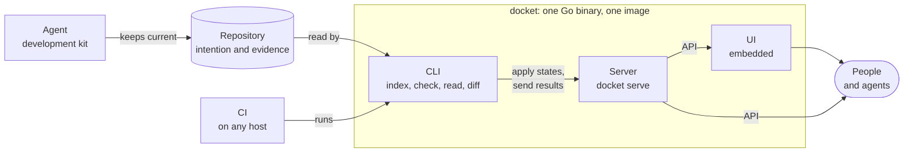

# docket

<a href="https://readme.exalynt.com/how-it-works/stability-levels#stability-prototype"><picture>
  <source media="(prefers-color-scheme: dark)" srcset="https://design.exalynt.io/stability/prototype-extra-long-dark.svg">
  
</picture></a>

What your software is meant to do, written beside the code, linked to the
evidence of what it actually does, and readable by everyone with a stake in it.

> [!WARNING]
> Docket is a **Prototype**, one of Exalynt's [stability levels](https://readme.exalynt.com/how-it-works/stability-levels). It explores an idea so we can choose a direction. Anything here, the format included, may change completely or be thrown away. Don't build on it yet.

Docket is an open format, and the tools that read it, for writing down what
your software is meant to do: its capabilities, the rules they follow, the
people they serve, how stable each one is, how it's meant to be built, and the
gaps and tradeoffs we know about. Each is a small plain-language doc in the
repository, changed in the same commit as the code. Code and tests point back
at them as evidence. Tools then show everyone, technical or not, what's
intended, what's real, and the gap between.

> [!NOTE]
> **Docket is documented with Docket.** The `docket.yaml` and `docket/` folder
> at the root of this repository are Docket's own docs, written in its own
> format: what Docket does, its rules, the concepts that define the format,
> and its gaps, tradeoffs and open decisions. They aren't `docket`'s code, and
> [`examples/`](examples/) holds made-up projects of their own. See
> [Docket documents itself](#docket-documents-itself).

**Contents:** [The problem](#the-problem) · [How it works](#how-it-works) · [Who it's for](#who-its-for) · [How it supports software engineering](#how-it-supports-software-engineering) · [What Docket isn't](#what-docket-isnt) · [Does it belong in Docket?](#does-it-belong-in-docket) · [Proposed architecture](#proposed-architecture) · [Where it is today](#where-it-is-today) · [Open questions](#open-questions) · [Docket documents itself](#docket-documents-itself) · [Layout](#layout)

## The problem

Docket exists to help people apply the discipline of software engineering to
their projects, with
[craft and judgment](https://readme.exalynt.com/how-it-works/software-engineering).
Judgment is only as sound as the evidence it rests on, and for most projects
that evidence is hard to find:

- **Code shows what the software does, not what it should do.** A bug looks
  just like a deliberate choice. A missing rule leaves nothing behind to read.
  A capability that's half built looks finished. An agent that reads the code
  can only guess at intention from behavior, and ends up explaining the bugs as
  if they were meant.
- **Intention isn't written down anywhere you can trust.** What the software
  must and must never do, what a word means to the business, and which rules
  must always hold live in people's heads, or are scattered across wikis,
  tickets, slide decks and chat. Each says something slightly different, so
  they get applied inconsistently.
- **What is written down has no link to the code.** It's kept apart from the
  code and written for one audience, so it drifts a little with every change,
  and nobody can tell whether it's still true until someone depends on the
  difference.
- **"Is this ready?" has no clear answer.** It's hard to tell which parts can
  be relied on today, which are still being explored, and what's left before a
  part is ready for the people who need it.
- **Only the people who write the code can read it.** Everyone else relies on
  someone translating it for them.
- **Agents make it worse, and could make it better.** AI agents now write much
  of the code. Without the software's purpose, rules and state written down,
  they guess. With them, they can help keep it accurate.

## How it works

Docket separates what the software is meant to do from what it does:

- **Intention is declared.** Docket's docs in a repository say what the
  software should do and must never do: its capabilities, the people they
  serve, the rules they follow, how stable each one is meant to be, and the
  gaps we know about. Beside them, technical docs say how it's meant to be
  built, in the code's words: the tradeoffs made on purpose, and the technical
  gaps still open. They're written before or alongside the code, so they can
  say what the software is meant to do even when it doesn't do it yet, or
  doesn't do it correctly.
- **Evidence is linked.** Code, tests and commits show what the software
  actually does. Docket links that evidence to the intention it's about, so you
  can go from a rule to the code that enforces it and the tests that check it.
  Evidence can take many forms, and we're deliberately keeping it open. Today
  it's annotations: a `docket:implements` or `docket:verifies` comment that
  says which rules, capabilities or mechanisms a place in the repository is
  about, and a `docket:gap` or `docket:tradeoff` comment that marks where a
  known gap or a deliberate choice shows in the code. Later it may include
  commits, pull requests, CI results and more.
- **State is derived.** Tools read both and work out everything else, which
  nobody writes by hand: each rule's evidence, each gap's **risk** (its
  declared impact, likelihood and reach, scored by the stability of what it's
  on and whether it breaks a claim made there), each feature's **maturity** (how far along
  it is), the **readiness** of each capability, feature,
  domain and persona (a recommendation of how ready people can rely on it
  being: maturity, less the risk its gaps carry, with what's left), and any
  problems in the docs themselves.
- **The difference is the work.** What's declared is taken to hold, unless
  it's declared that it doesn't, or the evidence contradicts it. Docket names
  the ways intention and reality differ, open decisions, gaps, tradeoffs and
  problems, and shows each where it matters, rather than hiding it or quietly
  resolving it. Evidence is optional: it shows how we know something holds,
  and none is never a to-do. See
  [where intention and reality differ](docket/domains/reporting/domain.md#where-intention-and-reality-differ).

That makes it easy for anyone, person or agent, technical or not, to:

- **See where the software is**: what it can do, who it does it for, and how
  stable each part is.
- **Know what's left**: each part's known gaps, and what its stability level
  expects that it doesn't yet meet. When and how to close them is the team's
  call.
- **Understand the domain**: what its concepts mean, and which rules must
  always hold.
- **Check the evidence**: go from any capability or rule to the code that
  implements it and the tests that verify it, and see what holds with
  evidence and what holds on trust.

Intention is written to be:

- **Understood by technical and non-technical people alike.** It's in the
  domain's words, never the code's: "a room can't be double-booked", not a
  database constraint.
- **Easy to discuss.** Each capability, rule and gap is a small doc of its own,
  with an ID people can point to in a review, a meeting or a pull request. What
  they decide there is written back into the repository.
- **Easy to take in.** One sentence per capability and one rule per file, and a
  UI shows all of it at a glance before anyone reads a word of code.
- **Plain Markdown and YAML**, which a person can write by hand. Docket works
  without agents, though we recommend them to get the most from it.

Agents can help write intention down, and can work it out from existing code, for
example to bring Docket to a repository that already exists. Intention taken
from code repeats what the code does, bugs included, so it's marked as
unconfirmed, and a person confirms each part before it counts as declared.

Docket's [Authoring](docket/domains/authoring/domain.md) and
[Reporting](docket/domains/reporting/domain.md) domains introduce its concepts
and show how they fit together: domains, features, capabilities, rules,
concepts, personas, initiatives, mechanisms and components, open decisions,
gaps and tradeoffs, stability levels and their rubric, maturity,
readiness and evidence. Each concept has a doc of its own, in its domain's
`concepts/` folder, that defines it precisely, with an example of how it's
written down.

## Who it's for

- **The people who build the software**, engineers and agents, who need to know
  what it's meant to do before they change it.
- **The people who depend on it**, such as product owners, designers, clients,
  support staff and users, who need to know what it does for them and what
  they can rely on, without reading code. That can include a product's own
  customers, through a view the team chooses to share with them.

Exalynt builds Docket and uses it first, on its own projects and its clients'.
The format belongs to no particular tool, so any team can adopt it, or write
its own indexer for it.

## How it supports software engineering

Exalynt defines
[software engineering](https://readme.exalynt.com/how-it-works/software-engineering)
as the discipline of applying engineering
[craft](https://readme.exalynt.com/how-it-works/software-engineering#engineering-craft)
and
[judgment](https://readme.exalynt.com/how-it-works/software-engineering#engineering-judgment)
to build software that delivers value to people, consistently behaves as
intended, and evolves gracefully.

A discipline is a set of shared standards that people hold each other to.
Docket gives a project's standards somewhere to live: an open format for writing
intention down, the stability rubric that says what each level means, and every
change to either reviewed in a pull request alongside the code.

### What the software should do

| The definition says the software…                                                                       | Docket gives it                                                                                                                                                                                      |
| ------------------------------------------------------------------------------------------------------- | ---------------------------------------------------------------------------------------------------------------------------------------------------------------------------------------------------- |
| **Delivers value to people**                                                                            | Personas and the capabilities that serve them, written down before the code so the people affected can say whether it's the right problem, and how ready the software is for each of them            |
| **Consistently behaves as intended**: does what it's meant to do and avoids what it isn't               | The intention itself, what it should do and must never do, with the code and tests linked to it as evidence. Behavior can't be checked against an intention nobody wrote down                        |
| **Evolves gracefully**: changes with confidence, without breaking what works, with effort in proportion | The rules a change must keep, and the tests that check them, visible before the change is made. Stability levels, so people know what they can depend on and effort stays in proportion to the level |

### Judgment

Exalynt defines judgment as the ability to evaluate tradeoffs amid uncertainty,
decide at the right moment, and take responsibility for the outcomes. Deciding
how much design, testing and polish the work needs for its stability level is
one of the places it's used. Docket gives each of these somewhere to be written
down:

| Judgment means…                            | Docket records                                                                                                                       |
| ------------------------------------------ | ------------------------------------------------------------------------------------------------------------------------------------ |
| **Evaluating tradeoffs**                   | Tradeoffs: what we chose instead of what, with its benefit and drawback                                                              |
| **Amid uncertainty**                       | Known gaps, open decisions, drafts, and Prototype and Alpha levels, so what isn't known or done yet is said plainly                  |
| **Deciding at the right moment**           | Open decisions, held where their answer will go until it's time to settle them                                                      |
| **Deciding how much is enough**            | Each capability's stability level, and the stability rubric: what that level generally expects, and what would be overengineering |
| **Taking responsibility for the outcomes** | Every decision made in a commit and reviewed in a pull request. Intention an agent writes counts only once a person confirms it      |

Sound judgment rests on evidence and is honest about uncertainty, and Docket
helps with both. It can't show whether a decision was made with integrity, or
with the people affected at its center. That's up to the people making it.

### Craft

Craft is how well the software is built: clear, simple, secure, dependable and
maintainable, and built with care. Docket can't judge code. It holds the
team's intention about how the software is built, and shows where the build
falls short of it:

- **Tradeoffs made on purpose**, with their benefit and drawback, and what
  would make us look again, so a shortcut someone chose isn't mistaken for one someone missed.
- **Deliberate code, marked.** A `docket:tradeoff` comment says code that
  looks wrong is meant to be that way, so neither a person nor an agent
  "fixes" it. A bug no longer looks just like a deliberate choice.
- **Technical gaps**, marked where they are in the code instead of as bare
  TODOs, and shown on every capability that relies on that code, ordered with
  product gaps by what's at stake.
- **The standard each stability level expects**, grouped by qualities such as
  reliability and security, with each outcome not met, not met by choice
  where a tradeoff says so, met with evidence from a mechanism that meets it,
  or met on trust.

What Docket shows about craft is still mostly what people declare. It makes
that declaration specific, and puts it beside the code it's about.

### Agents

Exalynt's view of
[AI in software engineering](https://readme.exalynt.com/how-it-works/ai-in-software-engineering)
is that AI's judgments often lack the circumstances behind a decision, and the
discipline supplies them: what the AI needs to know, and whether what comes
back is right. Docket gives agents the first, the declared intention, before
they change code. It leaves the second with people: nothing an agent writes
counts until a person confirms it.

Docket informs judgment and shows the standard of craft, but it does neither.
People decide what to build, what level a capability is at, and when a gap is
acceptable, and the craft is in the code they write. Docket makes those
decisions, and the evidence behind them, visible to everyone.

## What Docket isn't

- **A task tracker or roadmap.** It shows what's missing and what each level
  expects, never who will do the work, how long it will take or when. That's
  planned wherever you already plan.
- **A test runner or a quality gate.** It doesn't run tests or decide whether
  the software passes. It shows the evidence, in whatever form, for people to
  judge. It does check that the Docket docs themselves are correct, since they
  are only useful if they hold together.
- **A guarantee of accuracy.** People write intention and annotations, and
  people make mistakes. Docket gets you closer to the truth than going without,
  and points out what it can tell is wrong, but it never claims to be perfect.
- **A copy of what the code already says.** It records what the code can't
  show: what the software is meant to do, and the intention behind how it's
  built. Lists of endpoints, tables or services, and diagrams drawn from the
  code, stay in the code. Runbooks belong wherever a team keeps them.
- **A score to maximize.** Maturity is an indication, not a target. Starting
  new work lowers it, and 100% isn't the goal. Readiness is a recommendation
  for people to judge, and comes with what's left.
- **A place to change intention outside the repository.** Intention is only
  ever changed in a repository, so it's reviewed with the code. Servers and
  other tools read it and show it, never edit it.

## Does it belong in Docket?

Before adding something to Docket, ask:

1. **Does it make the software's intention, state or evidence easier to see,
   understand or keep accurate**, for someone who builds the software or has a
   stake in it?
2. **Does it keep the repository as the only place intention is declared?**
   Tools can read, show and combine it. They never become a second place to
   change it.
3. **Does it inform judgment, rather than make the decision?** Docket shows
   levels, gaps and evidence. People decide what they mean.
4. **Is it intention the code can't show?** What the software should do, in
   the domain's words, or how it's meant to be built and why, in the code's,
   and not what a reader could learn from the code in a few minutes.

Something that answers yes to all four probably belongs. Something that fails
one probably belongs in another tool, which Docket can link to. For example:

| Idea                                                                                    | Belongs?   | Why                                                                                         |
| --------------------------------------------------------------------------------------- | ---------- | ------------------------------------------------------------------------------------------- |
| A pull request comment previewing what the change does to the state                     | Yes        | Makes intention and evidence easier to see, in the review itself                            |
| An API agents query for a capability's rules and level before changing its code         | Yes        | Keeps agents' work tied to the declared intention                                           |
| A history of each capability's level, and of maturity, over time                        | Yes        | Shows where the software is going, all derived from the repository                          |
| Release notes for stakeholders, written from what changed in the state                  | Yes        | Makes the state easy to take in for people who don't read code                              |
| An editor that lets people who don't use git propose a change, as a pull request        | Yes, later | Opens intention to more people, and the change still lands in the repository                |
| A CI check that fails when the Docket docs are broken, such as a link to a missing rule | Yes, later | Keeps the docs correct. It checks the docs, never the software                              |
| Notifying people when a capability they depend on is demoted or its rules change        | Yes, later | Tells people when what they rely on changes                                                 |
| A known gap linking to the issue where its fix is tracked                               | Yes        | Connects the gap to the work, while planning stays in the tracker                           |
| A tradeoff, with its benefit and drawback, beside the code it explains                  | Yes        | Intention about how it's built that the code can't show                                     |
| A read-only view a team shares with its product's customers                             | Yes, later | Customers have a stake too, and see only what they're allowed to                            |
| Owners, estimates and due dates on known gaps                                           | No         | Planning the work is a task tracker's job (fails 1 and 3)                                   |
| Diagrams of services and components drawn from the code                                 | No         | The code already shows it (fails 4)                                                         |
| A coverage percentage on each capability                                                | No         | A score that stands in for judgment (fails 3)                                               |
| A complexity score for each component                                                   | No         | Measures the code rather than stating intention, and stands in for judgment (fails 3 and 4) |
| A form on the server that changes a capability without a commit                         | No         | Makes the server a second place to declare intention (fails 2)                              |

## Proposed architecture

Docket is planned as three parts: the format, the agent kit, and `docket`, one
Go program that does everything else. Only the format, the kit and an early UI
exist today (see [Where it is today](#where-it-is-today)).



Agents use the **kit** to keep a repository's intention and evidence current as
they build. The **`docket` CLI** reads the repository, on a laptop or in CI,
and sends each commit's state and its test results to the **server**, which
combines every project's state and shows it to everyone with a stake in the
software. The CLI and the server are the same program.

### 1. Agent development kit

Tooling, skills and rules that let agents understand a project through Docket,
and take part in applying software engineering discipline to it: reading a
capability's level and rules before changing it, writing docs and annotations
in the same change as the code, and recording gaps and decisions as they're
made.

It's optional. Docket works without agents, and the kit is how they make the
most of it. It's written for any agent, as an `AGENTS.md` block and an Agent
Skills skill, and each project adds its own instructions beside it. Agents do
the work through the `docket` command, so the kit needs it: it tells them
which command answers each question, rather than how to answer it by hand.
The kit is built into `docket`, and `docket kit` installs it into a project
and keeps it up to date. See [`kit/`](kit/).

### 2. Format

_A better name will come._ The format is how a repository declares the state
of its software, in docs, frontmatter and annotations, and the shape of the
state worked out from it. It's defined by Docket's own concept docs, starting
from the [Authoring](docket/domains/authoring/domain.md) domain, and the
[stability rubric](internal/rubric/rubric.yml), which says what each
stability level means, is built into `docket`. It belongs to no one tool: `docket` is one program
that reads it, and anyone can write another.

### 3. `docket`

One program, written in Go, that owns all of Docket's logic, shipped as a
single binary and as a single container image. The same binary is the CLI,
the server, and what serves the UI.

- **Go owns everything Docket works out.** Indexing a repository, checking
  it, combining projects, maturity, readiness, risk and exposure, and how
  things changed between commits are each written once, in Go. The CLI, the
  server and the UI can never disagree, since there's only one place each is
  worked out.
- **As a CLI**, engineers, agents and CI use it on a repository: to index and
  check its docs, ask what a change touches, list gaps, see how something has
  changed over time, and send states and test and QA results to the server.
  It works on any repository host and in any CI. Every read can come from the
  working tree, a commit or the server, for one project or the whole
  product. Its commands are drafted in [`cmd/docket/`](cmd/docket/).
- **As the server**, with `docket serve`, it's the central place where
  projects come together. It:
  - **Holds each project's applied state** at every commit on its main
    branch, with the test and QA results sent for each, and combines projects
    into one view of the product, showing contradictions between them.
  - **Offers an API**, so the UI, agents and other tools can ask about the
    software's state, now and at any commit, instead of reading every
    repository.
  - **Serves the UI.**
  - **Serves one client.** Each client gets a Docket server of their own,
    so one never holds another's projects. It keeps what it holds in SQLite.
    It has no sign-in yet, so a server holding a client's real projects must
    only be reachable by that client's people, such as on a private network.
- **As a local viewer**, with `docket ui`, it serves the same UI over a
  repository's working tree, so anyone can see their branch the way the
  server will show it. It's only reachable from the machine it runs on, and
  needs no sign-in.
- **The UI only shows things.** It's a web app built into the binary. It gets
  everything it shows from the API, derived figures included, and works
  nothing out itself, whether it's served by `docket serve` or `docket ui`.
  It shows what the software can do, who it serves, how ready it is, the
  rules each capability follows, its known gaps, its evidence, and how all of
  it has changed.
- **One image runs it all.** The image holds the binary, and runs
  `docket serve` unless told to run another command, so the same image
  deploys the server and runs `docket apply` in a CI that works in
  containers. The binary is also released on its own, for laptops and CI.

[How `docket` is built](docs/architecture/) plans its code: where its logic
lives, how the CLI and the server share it, and the API the UI reads.

The CLI reconciles each project with the server, much as infrastructure as
code does:

- **Preview** shows what merging a branch would change on the server:
  capabilities added or promoted, gaps closed, decisions answered and what
  they became, rules with new evidence, new problems.
- **Apply** sends each new commit on the main branch, so the server reflects
  the repository.

The repository owns intention, and the server owns what was observed. Intention
is only ever declared in the repository, and the server is never edited
directly. The server holds the state at each commit and the results sent for
it. How things changed is worked out from git, so the server's history can
always be rebuilt from the repository.

## Where it is today

| Part                  | Today                                                                                                                                                                 |
| --------------------- | --------------------------------------------------------------------------------------------------------------------------------------------------------------------- |
| Format                | A draft for review, defined by Docket's concept docs, starting from the [Authoring](docket/domains/authoring/domain.md) domain, with example projects laid out as repositories in [`examples/`](examples/). |
| `docket`              | Indexes and checks a project, and applies its states to the server, which keeps them in SQLite and checks them with the same check. The rest of the commands drafted in [`cmd/docket/`](cmd/docket/) exist with their flags, and answer that they aren't built yet. The examples' `state.json` files are written by hand to show what indexing should produce. |
| UI                    | An early UI in TypeScript that reads `state.json` files directly and works out maturity, readiness and risk itself, until `docket` serves them. See [`ui/`](ui/).     |
| Agent development kit | A first draft for any agent: an `AGENTS.md` block and a `docket` skill, written for `docket` as drafted, so it can't be installed or used until `docket` is built. See [`kit/`](kit/). |

## Open questions

What we haven't decided yet is written down as open decisions in Docket's
own docs, on the domain or capability each is about, such as
[what to call the format](docket/domains/authoring/capabilities/docs-format.md)
and [how people sign in to a server](docket/domains/reporting/capabilities/applying.md).
`docket check` at the root of this repository indexes them, and the UI shows
them.

## Docket documents itself

We use Docket to build Docket, so this repository is a Docket project as well
as the home of the format. Docket's own docs define the format too: what a
capability or a gap is, and how each is written, are concepts of Docket's own
domains. It's easy to mix up what's Docket's and what's an example, so:

| What                                | Where                                                                | It says                                                                                               |
| ----------------------------------- | -------------------------------------------------------------------- | ----------------------------------------------------------------------------------------------------- |
| **Docket, the product**             | [`docket.yaml`](docket.yaml) and [`docket/`](docket/)                 | What Docket does and must never do, in Docket's format: its capabilities, rules, personas, and its gaps, tradeoffs and open decisions |
| **The format**                      | The concepts in [`docket/domains/*/concepts/`](docket/domains/authoring/concepts/) | What the words mean: what a capability, rule or gap is, and how each is written                       |
| **The stability rubric**            | [`internal/rubric/rubric.yml`](internal/rubric/rubric.yml) | What each stability level expects, built into `docket`, and explained by the [stability rubric](docket/domains/authoring/concepts/rubric.md) concept |
| **How `docket` is built**           | [`docs/architecture/`](docs/architecture/)                            | How the code is laid out and why, linked from the components in `docket/`                             |
| **Examples**                        | [`examples/`](examples/)                                              | Other, made-up projects, each a Docket project of its own                                              |

- **What we're working on lives in `docket/`.** Gaps, tradeoffs and open
  decisions are written there, on the capability, feature, mechanism or
  component they're about, not as lists in the other docs.
- **A concept defines a word, and a rule is one Docket follows.** The
  [rule](docket/domains/authoring/concepts/rule.md) concept says what a rule
  is in any project. A rule doc in `docket/`, such as "nothing is read from
  an ignored file", is a rule Docket itself follows.
- **The examples are separate projects.** Each has a `docket.yaml` of its own,
  so indexing this repository leaves them out.
- **[`.docketignore`](.docketignore) leaves out the kit's skill files.** They
  show example annotations about the hotel projects, which would otherwise
  be read as Docket's own evidence. Docket's own docs can show examples
  freely, since annotations are never read from a Docket doc.

`docket check` at the root checks Docket's own docs, and `docket index` then
`docket ui` shows them.

## Layout

| Directory                    | What's in it                                                                                                     |
| ---------------------------- | ---------------------------------------------------------------------------------------------------------------- |
| [`docket/`](docket/)         | Docket's own Docket docs: what it does, the concepts that define the format, and its gaps, tradeoffs and open decisions (see [Docket documents itself](#docket-documents-itself)) |
| [`docs/`](docs/)             | [How `docket` is built](docs/architecture/)                                                                       |
| [`examples/`](examples/)     | Example projects laid out as repositories, each with the `state.json` indexing would produce                     |
| [`kit/`](kit/)               | The agent development kit: skills and rules that keep docs and annotations current                               |
| [`cmd/docket/`](cmd/docket/) | `docket`, the Go program that's the CLI and the server, with the draft of its commands                           |
| `internal/`                  | `docket`'s code, and the [stability rubric](internal/rubric/rubric.yml) it's built with                  |
| [`ui/`](ui/)                 | The UI `docket` serves, built into the binary                                                                    |

## Developing

```sh
cp compose.override.example.yml compose.override.yml   # publishes the server on localhost:8090
make build      # build and start the server in Docker
make run        # or run it on this machine, on localhost:8080
make ui         # the UI's dev server, over examples/
make help       # everything else
```

`docket ui` shows the built UI over one project's `.docket/state.json`, on
http://127.0.0.1:4100:

```sh
make ui-build
go run ./cmd/docket -C examples/hotel-bookings ui
```

Index and check a project, then send its state to a local server. The
examples are folders in this repository, so `apply` sends their state at each
commit of it:

```sh
go run ./cmd/docket -C examples/hotel-bookings check          # its problems, exit 1 if any
go run ./cmd/docket -C examples/hotel-bookings index --stdout # its state
make run                                                      # migrate, then serve on localhost:8080
DOCKET_SERVER=http://localhost:8080 go run ./cmd/docket -C examples/hotel-bookings apply
curl localhost:8080/api/v1/projects/hotel-bookings/state      # the state the server keeps
```

`docket index` without `--stdout` writes over an example's hand-written
`state.json`.

`docket serve` and `docket migrate` read these, each also a flag:

| Variable        | Flag           | Default          | What it does                                      |
| --------------- | -------------- | ---------------- | ------------------------------------------------- |
| `PORT`          | `--port`       | `8080`           | The port `serve` listens on                       |
| `LOG_LEVEL`     | `--log-level`  | `info`           | The lowest level logged: debug, info, warn, error |
| `LOG_FORMAT`    | `--log-format` | `json`           | `json` for log pipelines, `text` for reading      |
| `DATABASE_PATH` | `--database`   | `data/docket.db` | The server's SQLite database                      |

`docket apply` sends to the server in the project's `docket.yaml`, as
`server:`, or in `DOCKET_SERVER`, which wins.

`go build` embeds the UI from `ui/dist`, so run `make ui-build` first to
serve the real UI. Docker always builds it.
