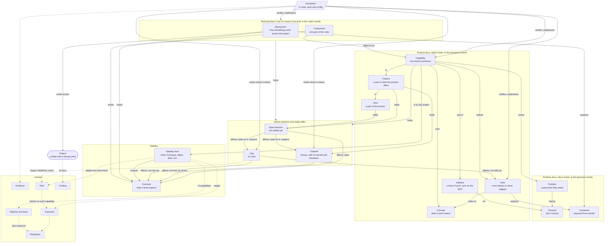

Docqet's format is how a repository records what its software is meant to
do, so that people, agents and tools can all read it. It belongs to no
particular tool: anyone can adopt it or write their own indexer for it.

Docqet's [concepts](../concepts/) are the format's definition. Each concept
doc says what a word means, how it's written down, and every rule about it.
When a concept doc and a word in the code or the UI disagree, the concept doc
is what we intend, and the other one is wrong. Start here, read the big picture, then follow
[every concept](#every-concept) in the order listed.

Examples come from [`examples/`](../../examples/), each laid out as its
own repository root: a hotel's booking app and its billing service, two
projects in one product, and Exalynt, a real product at full size. The
format's open decisions are `decisions` on Docqet's own capabilities and
areas, such as [intention docs](../capabilities/docs-format.md).

## Principles

- **The repo is the source of truth.** Everything is declared in the
  repository or derived from it.
- **Declared vs. derived.** People and agents write the declared parts:
  stability, rules, decisions, gaps, tradeoffs and links. The indexer
  computes the derived parts: evidence, reverse links and findings. Readers
  work out what depends on other projects, such as maturity, readiness, risk,
  and which outcomes a capability meets with evidence. Nobody edits derived
  state by hand. See [declared and derived](../concepts/declared-and-derived.md).
- **Why, what and how.** Problem docs say why the software exists, and what
  it must keep to: the problems people have, in their words, and the
  constraints imposed on it from outside, never naming the software. Product
  docs say what it does, in the business's words, and never name its
  implementation. Technical docs say how it's meant to be built, in the
  code's words. [Links only point toward why](#problem-space-and-solution-space).
- **Evidence is optional.** Code and tests can point at the rules they're
  about, so readers can see them beside the rule. Docqet doesn't run tests or
  read their results, and nothing requires evidence at any level.
- **Structure in frontmatter, never in the body.** Each
  [doc](../concepts/doc.md) is Markdown. Everything the format defines is a
  field in its YAML frontmatter. Its body is free Markdown for anything more
  worth saying, with no structure anyone can rely on. No fact is in both.
- **Contradictions are shown, not resolved.** Each project contributes what
  it knows to one picture of the product. Where two contributions disagree,
  readers see both and a [finding](../concepts/finding.md), not a winner.

## The big picture

A **[software product](../concepts/product.md)** is the end result
of one or more pieces of software working together to accomplish a
high-level goal, such as a hotel's booking app and billing service. Each
piece is a **[project](../concepts/project.md)**: a folder marked by a
`docqet.yaml`, where software is defined in **[docs](../concepts/doc.md)**, and
usually implemented. A project is often a whole repository, and can be one
package of several in one. Docqet shows one product at a time. Every project
contributes what it knows to one picture of the whole product: the same ID
in two projects is one doc, and where they say different things, Docqet
shows the **[contradiction](../concepts/contradiction.md)** rather than
picking one.

Why the software exists comes first. A **[persona](../concepts/persona.md)** is a
type of person the software serves, such as a front desk clerk. A
**[problem](../concepts/problem.md)** is a pain point one or more personas share,
such as guests being turned away when rooms are free, said in their words and
never naming the software. A **[constraint](../concepts/constraint.md)** is
something imposed from outside that any solution must respect, such as a tax
law or a fact of the building.

An **[area](../concepts/area.md)** is a part of the product, such as Guest
stays or Billing, that groups **[features](../concepts/feature.md)**, each a
part of what the product offers, such as Reservations. A feature's
**[capabilities](../concepts/capability.md)** are each one result the product
produces, such as room booking. Each names the one it's in: a capability its
feature, and a feature its area. Each capability says which problems it
solves, and serves the personas who have them, so Docqet can show, for
each problem and each persona, what the software does about it and how ready
that is. A feature can have capabilities from several projects, each
contributing its part. Each capability has a
**[stability level](../concepts/stability-level.md)** in each project that
builds it, follows **[rules](../concepts/rule.md)**, and uses
**[concepts](../concepts/concept.md)**. Rules and concepts belong to the
product as a whole, with one ID each. A capability refers to the ones it
follows and uses, so one rule can apply to many capabilities, in different
features and areas. A rule says which constraints it respects, when it's
there to keep to one. What each level generally means and expects is in the
**[stability rubric](../concepts/rubric.md)**.

An **[initiative](../concepts/initiative.md)** is a body of work, such as the
MVP or the hotel's busy season. Each capability says which initiatives it's
part of, and each initiative names the personas its work is for, so Docqet
can show the whole product or one initiative alone, and every number counts
only what's showing.

How the software is meant to be built is written down beside that, in the
code's words: **[mechanisms](../concepts/mechanism.md)**, each how something
works across the whole project, and **[components](../concepts/component.md)**,
each one part of the code. A component lists the capabilities that rely on
it; a mechanism applies to every capability its project, or its whole
product, serves.

Intention and reality differ in a few named ways:
**[open decisions](../concepts/open-decision.md)**, **[gaps](../concepts/gap.md)**,
**[tradeoffs](../concepts/tradeoff.md)** and **[findings](../concepts/finding.md)**.
[Understanding](understanding.md#where-intention-and-reality-differ) sets
out where each is declared, and what's open.

Anything in the repository can point at a rule, capability, mechanism or
component with an **[annotation](../concepts/annotation.md)**, as evidence that
it verifies or implements it, or mark where a gap or tradeoff shows in the
code. A commit can say what something it removed became with a
**[trailer](../concepts/trailer.md)**, so history can follow it. The
**[indexer](../concepts/indexer.md)** reads all of it, and works out each one's
evidence and any findings. Readers then work out how far along and how ready
it all is, as [understanding](understanding.md) describes.

Intention is only worth reading while it's true, so it's kept current in the
same change as the code it describes: before a change, people and agents see
what it touches and what its levels allow, and before it's merged, the check
finds anything in the docs that's wrong, and every rename or removal says
what it became. That's [keeping intention current](../features/keeping-current.md),
and it's what keeps the docs from describing software that's gone.

Solid arrows are [declared](../concepts/declared-and-derived.md): written in a
doc. Dashed arrows and boxes are derived from them, and nobody writes them by
hand. An arrow into a group means some of what's in it:
[which each one holds](understanding.md#where-intention-and-reality-differ)
is set out in understanding.

## Problem space and solution space

Docqet's docs are in two spaces, the way people already talk about software:

| Space              | Docs                                                                                | Say                                            | In whose words          |
| ------------------ | ----------------------------------------------------------------------------------- | ---------------------------------------------- | ----------------------- |
| **Problem space**  | Personas, problems and constraints                                                  | **Why**: the pain, who has it, and what any solution must keep to | The persona's, or the world's |
| **Solution space** | **Product docs**: areas, features, capabilities, rules, concepts and initiatives    | **What** the software does, seen from outside  | The business's          |
|                    | **Technical docs**: mechanisms and components                                       | **How** it's built, seen from inside           | The code's              |

Product and technical docs differ by what can be seen, not by how detailed
they are. "A room is never booked twice for one night" is detailed, and still
product: anyone using the software can see it hold. "Each release replaces
the running one only once it's healthy" is broad, and still technical: nobody
using it can tell.

- **Links only point toward why.** A link is written in the more concrete
  doc and names the more general one. Across the spaces, that's from code
  to technical docs, to product docs, to problem docs, though a link can skip
  a space: technical docs link to the capabilities they serve, capabilities
  to the problems they solve, initiatives to the personas they're for, and
  rules and mechanisms to the constraints they respect. Product docs never
  link to technical docs, and problem docs never link to product docs, so a
  problem stays true whatever solves it, and a capability stays the same
  however it's built. Within a space, links point up: a capability names its
  feature, and a feature its area. Docqet works out every reverse link.
- **A problem never names the software.** It's the pain as the people who
  have it would say it, and would still be true if the software didn't
  exist.
- **The spaces say what a doc describes, not who decides it.** A problem
  isn't product's alone, and a capability isn't something product hands
  engineering: which capabilities solve a problem is a choice the team makes
  together, reviewed like any other change.
- **There are no language boundaries.** Rule and concept IDs are one across
  the product, and an [area](../concepts/area.md) is only a grouping of
  features. A word that means two things in two parts of the business is two
  [concepts](../concepts/concept.md), with different IDs, each saying how it
  differs from the other.

Four questions place a doc:

- **Problem or capability?** Would it still be true if the software didn't
  exist? Then it's a problem.
- **Constraint or rule?** Would it still apply if the software were rebuilt
  from scratch, any way the team liked? Then it's a constraint, and the rule
  is the software's promise to keep to it.
- **Capability or technical?** Could it be built a completely different way
  and still be the same? Then it's a capability.
- **Feature or capability?** Would someone using it name it as a part of the
  product? Then it's a feature. One result, with a stability level, is a
  capability.

## Agnostic of implementation

Areas, features and capabilities say what value the software provides,
never how it's built or delivered. A capability is the same capability
whether people use it through a web page, a mobile app, an API or a command
line, whether it runs as one service or ten, and whatever language,
framework or vendor is behind it.

- **They're described in the business's words.** Their names, summaries and
  what they cover name no screens, buttons, endpoints, services, tables,
  functions, technologies or vendors. "Clerks book a room for a guest's
  stay", not "clerks submit the booking form" or "the bookings API creates a
  reservation".
- **Changing the implementation doesn't change them.** A rewrite, a new
  framework, splitting or merging services, or moving to another vendor
  never creates, removes, renames or splits an area, feature or capability.
  If the software produces the same results of value afterwards, they're the
  same ones.
- **Delivery isn't a capability.** Offering room booking through an app as
  well as the web is another way to reach the same result, so it's part of
  room booking. It becomes a capability of its own only if it produces a
  result of value that wasn't possible before.
- **Implementation and value don't line up one to one.** One capability can
  be built from code in several places, and one piece of code can serve
  several capabilities.

A capability names no code. How it's built, and what we intend about that,
is in [technical docs](#how-its-built), which link to the capabilities they
serve and never the other way.

## How it's built

How the software is built, written for the engineer or agent about to change
it, in [mechanisms](../concepts/mechanism.md) and
[components](../concepts/component.md). Product docs say what the software
does, in the business's words, and never name its implementation. Technical
docs say how it's built, in the code's words, and what we intend about that:
the choices we made on purpose, what isn't done yet, and what will surprise
whoever changes it next. That's technical intention, and the code can't show
it.

They hold only what a competent reader couldn't learn from the code in a few
minutes. Most code needs none. A list of endpoints, tables or functions is
left out, since the code already says it.

- **They link to the capabilities they serve**, never the other way, so
  product docs stay the same whatever the implementation. A component lists
  them; a mechanism applies to every capability its project, or its product,
  serves.
- **They have no stability level.** One can serve capabilities at different
  levels, so a level always names its capability.
- **They're in no area.** They're written in the code's words, not the
  business's.
- **They're one across every project by ID**, as features are. A mechanism
  that spans projects has its whole picture in the one that owns it.

## Feature, capability or neither?

Ask what value the work adds:

| The work                                                              | Is                                                                      |
| --------------------------------------------------------------------- | ----------------------------------------------------------------------- |
| Answers a pain nothing in the software answers yet                    | A problem, if it isn't written down already, then what follows below    |
| Gives the software a part it didn't have at all                       | A new feature, with the capabilities that start it                      |
| Produces a new result toward a part the software already has          | A new capability of that feature, a draft until it's started            |
| Adds another way to reach a result a capability already produces      | Part of that capability                                                 |
| Makes a capability better at what it does                             | A change to that capability, often closing one of its gaps              |
| Only changes how something is built                                   | Neither, though it may close a mechanism's or component's technical gap |

A rough check: why someone needs the software at all is a problem. The part
of the software they come to is a feature. What they get done while they're
there is a capability.

Some things are never features or capabilities:

- **A step or action**, such as picking dates or seeing which rooms are
  free, is part of a capability, unless it produces a result of value by
  itself.
- **A screen, page, endpoint or service** is how a capability is delivered,
  not what it is.
- **A problem** is why a capability exists, never the capability itself.
- **A rule** is a promise capabilities keep while they do their jobs:
  something that must always be true, or must never happen.
- **A quality**, such as being fast, accessible or secure, is how well
  capabilities do their job. Where one falls short, that's a gap in the
  capability.

## Every concept

In the order to read them.

**The product**

- [Software product](../concepts/product.md): the end result of one
  or more pieces of software working together to accomplish a high-level
  goal.
- [Project](../concepts/project.md): one piece of a product, a folder with a
  `docqet.yaml`, where software is defined.
- [Contradiction](../concepts/contradiction.md): two projects
  saying different things that should agree.

**The problem space**

- [Persona](../concepts/persona.md): a type of person the software serves.
- [Problem](../concepts/problem.md): a pain point one or more personas share,
  never naming the software.
- [Constraint](../concepts/constraint.md): something imposed from outside that
  any solution must respect.

**The solution space**

- [Area](../concepts/area.md): a part of the product that groups features.
- [Feature](../concepts/feature.md): a part of what the product offers.
- [Capability](../concepts/capability.md): one result the product produces,
  solving part of one or more problems.
- [Rule](../concepts/rule.md): what must always be true, or must never happen.
- [Concept](../concepts/concept.md): what a word means.
- [Initiative](../concepts/initiative.md): a body of work, such as the MVP, so
  it can be seen on its own.

**How it's built**

- [Mechanism](../concepts/mechanism.md): how something works across a whole
  project.
- [Component](../concepts/component.md): one part of the code.

**Where intention and reality differ**

- [Open decision](../concepts/open-decision.md): a question not settled yet.
- [Gap](../concepts/gap.md): something we intend to close.
- [Tradeoff](../concepts/tradeoff.md): something we chose, knowing its benefit
  and drawback.
- [Risk](../concepts/risk.md): what's at stake in a gap, scored
  from its impact, likelihood and reach, the level of each capability it's
  on, and whether it breaks a claim made there, and its spread, how that
  spreads across them.
- [Exposure](../concepts/exposure.md): what the gaps open on some
  capabilities put at stake together: to risk what maturity is to stability.

**Stability, maturity and readiness**

- [Stability level](../concepts/stability-level.md): how much people can depend
  on a capability.
- [Stability rubric](../concepts/rubric.md): what each level generally
  means and expects.
- [Maturity](../concepts/maturity.md): how far along a feature,
  area, project, initiative, or what serves a persona, is.
- [Band](../concepts/band.md): the quarter of the maturity scale
  something is in.
- [Readiness](../concepts/readiness.md): how ready people can rely
  on the software being, as a recommendation, with what it still needs.

**Evidence and history**

- [Evidence](../concepts/evidence.md): places that verify or implement
  something.
- [Annotation](../concepts/annotation.md): the comment that makes a place
  evidence, or marks a gap or tradeoff.
- [Trailer](../concepts/trailer.md): a line at the end of a commit message that
  says what something the commit removed became.

**Docqet itself**

- [Doc](../concepts/doc.md): one Markdown file describing one thing.
- [Link](../concepts/link.md): a relationship, written once, in one direction.
- [Declared and derived](../concepts/declared-and-derived.md): what people
  write, and what's worked out.
- [Indexer](../concepts/indexer.md): the program that works out the state.
- [State](../concepts/state.md): a snapshot of a project at one commit.
- [Finding](../concepts/finding.md): something wrong in the docs.
