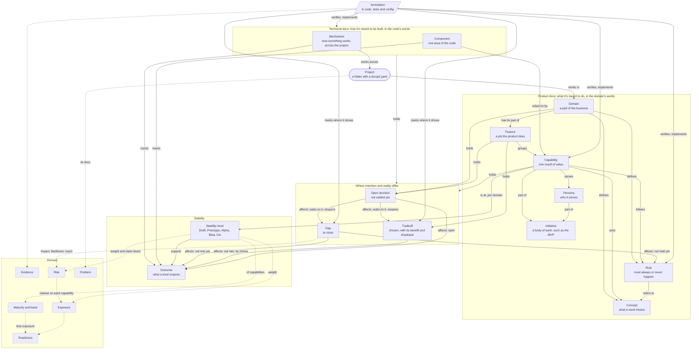

Docqet's format is how a repository records what its software is meant to
do, so that people, agents and tools can all read it. It belongs to no
particular tool: anyone can adopt it or write their own indexer for it.

This domain's [concepts](concepts/), with [reporting's](../reporting/domain.md),
are the format's definition. Each concept doc says what a word means, how
it's written down, and every rule about it. When a concept doc and a word in
the code or the UI disagree, the concept doc is what we intend, and the other
one is wrong. Start here, read the big picture, then follow
[every concept](#every-concept) in the order listed.

Examples come from [`examples/`](../../../examples/), each laid out as its
own repository root: a hotel's booking app and its billing service, two
projects in one product, and Exalynt, a real product at full size. The
format's open decisions are `decisions` on Docqet's own capabilities and
domains, such as [intention docs](capabilities/docs-format.md).

## Principles

- **The repo is the source of truth.** Everything is declared in the
  repository or derived from it.
- **Declared vs. derived.** People and agents write the declared parts:
  stability, rules, decisions, gaps, tradeoffs and links. The indexer
  computes the derived parts: evidence, reverse links and problems. Readers
  work out what depends on other projects, such as maturity, readiness, risk,
  and which outcomes a capability meets with evidence. Nobody edits derived
  state by hand. See [declared and derived](concepts/declared-and-derived.md).
- **Intention about the product, and about how it's built.** Product docs say
  what the software does, in the domain's words, and never name its
  implementation. Technical docs say how it's meant to be built, in the
  code's words, and link to the product, never the other way.
- **Evidence is optional.** Code and tests can point at the rules they're
  about, so readers can see them beside the rule. Docqet doesn't run tests or
  read their results, and nothing requires evidence at any level.
- **Structure in frontmatter, never in the body.** Each
  [doc](concepts/doc.md) is Markdown. Everything the format defines is a
  field in its YAML frontmatter. Its body is free Markdown for anything more
  worth saying, with no structure anyone can rely on. No fact is in both.
- **Contradictions are shown, not resolved.** Each project contributes what
  it knows to one picture of the product. Where two contributions disagree,
  readers see both and a [problem](concepts/problem.md), not a winner.

## The big picture

A **[software product](../reporting/concepts/product.md)** is the end result
of one or more pieces of software working together to accomplish a
high-level goal, such as a hotel's booking app and billing service. Each
piece is a **[project](concepts/project.md)**: a folder marked by a
`docqet.yaml`, where software is defined in **[docs](concepts/doc.md)**, and
usually implemented. A project is often a whole repository, and can be one
package of several in one. Docqet shows one product at a time. Each project
works in one or more **[domains](concepts/domain.md)**: parts of the
business, each with its own language, such as Guest stays or Billing. Every
doc but a persona, an initiative, a mechanism or a component is written in
exactly one domain. Every project contributes what it knows to one picture
of the whole product, and where two of them say different things, Docqet
shows the **[contradiction](../reporting/concepts/contradiction.md)** rather
than picking one.

A **[feature](concepts/feature.md)** is a job the product does, and it groups
the **[capabilities](concepts/capability.md)** that do that job. Features and
capabilities can span domains: each domain that does part of the work
contributes its part. Each capability has a
**[stability level](concepts/stability-level.md)** in each domain that builds
it, follows **[rules](concepts/rule.md)**, and uses
**[concepts](concepts/concept.md)**. Rules and concepts belong to a domain,
and mean what they say there. A capability refers to the ones it follows and
uses, so one rule can apply to many capabilities, in different features and
domains. What each level generally means and expects is in the
**[stability rubric](concepts/rubric.md)**.

A **[persona](concepts/persona.md)** is a type of person the software serves,
such as a front desk clerk. Each capability says which personas it serves, so
Docqet can show, for each of them, what the software does for them and how
ready it is for them.

An **[initiative](concepts/initiative.md)** is a body of work, such as the
MVP or the hotel's busy season. Each capability, and each persona the work is
for, says which initiatives it's part of, so Docqet can show the whole
product or one initiative alone, and every number counts only what's
showing.

How the software is meant to be built is written down beside that, in the
code's words: **[mechanisms](concepts/mechanism.md)**, each how something
works across the whole project, and **[components](concepts/component.md)**,
each one area of the code. A component lists the capabilities that rely on
it; a mechanism applies to every capability its project, or its whole
product, serves.

Intention and reality differ in a few named ways:
**[open decisions](concepts/open-decision.md)**, **[gaps](concepts/gap.md)**,
**[tradeoffs](concepts/tradeoff.md)** and **[problems](concepts/problem.md)**.
[Reporting](../reporting/domain.md#where-intention-and-reality-differ) sets
out where each is declared, and what's left.

Anything in the repository can point at a rule, capability, mechanism or
component with an **[annotation](concepts/annotation.md)**, as evidence that
it verifies or implements it, or mark where a gap or tradeoff shows in the
code. A commit can say what something it removed became with a
**[trailer](concepts/trailer.md)**, so history can follow it. The
**[indexer](concepts/indexer.md)** reads all of it, and works out each one's
evidence and any problems. Readers then work out how far along and how ready
it all is, as [reporting](../reporting/domain.md) describes.

Solid arrows are [declared](concepts/declared-and-derived.md): written in a
doc. Dashed arrows and boxes are derived from them, and nobody writes them by
hand. An arrow into a group means some of what's in it:
[which each one holds](../reporting/domain.md#where-intention-and-reality-differ)
is set out in reporting.

## Agnostic of implementation

Domains, features and capabilities say what value the software provides,
never how it's built or delivered. A capability is the same capability
whether people use it through a web page, a mobile app, an API or a command
line, whether it runs as one service or ten, and whatever language,
framework or vendor is behind it.

- **They're described in the domain's words.** Their names, summaries and
  what they cover name no screens, buttons, endpoints, services, tables,
  functions, technologies or vendors. "Clerks book a room for a guest's
  stay", not "clerks submit the booking form" or "the bookings API creates a
  reservation".
- **Changing the implementation doesn't change them.** A rewrite, a new
  framework, splitting or merging services, or moving to another vendor
  never creates, removes, renames or splits a domain, feature or capability.
  If the software produces the same results of value afterwards, they're the
  same ones.
- **Delivery isn't a capability.** Offering room booking through an app as
  well as the web is another way to reach the same result, so it's part of
  room booking. It becomes a capability of its own only if it produces a
  result of value that wasn't possible before.
- **Implementation and value don't line up one to one.** One capability can
  be built from code in several places, and one piece of code can serve
  several capabilities.

A capability names no code. How it's built, and what we intend about that,
is in [technical docs](#how-its-built), which link to the capabilities they
serve and never the other way.

## How it's built

How the software is built, written for the engineer or agent about to change
it, in [mechanisms](concepts/mechanism.md) and
[components](concepts/component.md). Product docs say what the software
does, in the domain's words, and never name its implementation. Technical
docs say how it's built, in the code's words, and what we intend about that:
the choices we made on purpose, what isn't done yet, and what will surprise
whoever changes it next. That's technical intention, and the code can't show
it.

They hold only what a competent reader couldn't learn from the code in a few
minutes. Most code needs none. A list of endpoints, tables or functions is
left out, since the code already says it.

- **They link to the capabilities they serve**, never the other way, so
  product docs stay the same whatever the implementation. A component lists
  them; a mechanism applies to every capability its project, or its product,
  serves.
- **They have no stability level.** One can serve capabilities at different
  levels, so a level always names its capability.
- **They're in no domain.** They're written in the code's words, not a
  domain's.
- **They're one across every project by ID**, as features are. A mechanism
  that spans projects has its whole picture in the one that owns it.

## Feature, capability or neither?

Ask what value the work adds:

| The work                                                              | Is                                                                      |
| --------------------------------------------------------------------- | ----------------------------------------------------------------------- |
| Gives the software a job it didn't do at all                          | A new feature, with the capabilities that start doing it                |
| Produces a new result of value toward a job the software already does | A new capability of that feature, a draft until it's started            |
| Adds another way to reach a result a capability already produces      | Part of that capability                                                 |
| Makes a capability better at what it does                             | A change to that capability, often closing one of its gaps              |
| Only changes how something is built                                   | Neither, though it may close a mechanism's or component's technical gap |

A rough check: the reason someone uses part of the software is a feature.
What they get done while they're there is a capability. The parts of the
business whose language they're in are its domains.

Some things are never features or capabilities:

- **A step or action**, such as picking dates or seeing which rooms are
  free, is part of a capability, unless it produces a result of value by
  itself.
- **A screen, page, endpoint or service** is how a capability is delivered,
  not what it is.
- **A rule** is a constraint capabilities do their jobs under: something
  that must always be true, or must never happen.
- **A quality**, such as being fast, accessible or secure, is how well
  capabilities do their job. Where one falls short, that's a gap in the
  capability.

## Every concept

In the order to read them, across both domains.

**The product**

- [Software product](../reporting/concepts/product.md): the end result of one
  or more pieces of software working together to accomplish a high-level
  goal.
- [Project](concepts/project.md): one piece of a product, a folder with a
  `docqet.yaml`, where software is defined.
- [Contradiction](../reporting/concepts/contradiction.md): two projects
  saying different things that should agree.
- [Domain](concepts/domain.md): a part of the business, with a language of
  its own.
- [Feature](concepts/feature.md): a job the software does.
- [Capability](concepts/capability.md): the software's ability to produce one
  result of value.
- [Rule](concepts/rule.md): what must always be true, or must never happen.
- [Concept](concepts/concept.md): what a word means in a domain.
- [Persona](concepts/persona.md): a type of person the software serves.
- [Initiative](concepts/initiative.md): a body of work, such as the MVP, so
  it can be seen on its own.

**How it's built**

- [Mechanism](concepts/mechanism.md): how something works across a whole
  project.
- [Component](concepts/component.md): one area of the code.

**Where intention and reality differ**

- [Open decision](concepts/open-decision.md): a question not settled yet.
- [Gap](concepts/gap.md): something we intend to close.
- [Tradeoff](concepts/tradeoff.md): something we chose, knowing its benefit
  and drawback.
- [Risk](../reporting/concepts/risk.md): what's at stake in a gap, scored
  from its impact, likelihood and reach, the level of each capability it's
  on, and whether it breaks a claim made there, and its spread, how that
  spreads across them.
- [Exposure](../reporting/concepts/exposure.md): what the gaps open on some
  capabilities put at stake together: to risk what maturity is to stability.

**Stability, maturity and readiness**

- [Stability level](concepts/stability-level.md): how much people can depend
  on a capability.
- [Stability rubric](concepts/rubric.md): what each level generally
  means and expects.
- [Maturity](../reporting/concepts/maturity.md): how far along a feature,
  domain, project, initiative, or what serves a persona, is.
- [Band](../reporting/concepts/band.md): the quarter of the maturity scale
  something is in.
- [Readiness](../reporting/concepts/readiness.md): how ready people can rely
  on the software being, as a recommendation, with what it still needs.

**Evidence and history**

- [Evidence](concepts/evidence.md): places that verify or implement
  something.
- [Annotation](concepts/annotation.md): the comment that makes a place
  evidence, or marks a gap or tradeoff.
- [Trailer](concepts/trailer.md): a line at the end of a commit message that
  says what something the commit removed became.

**Docqet itself**

- [Doc](concepts/doc.md): one Markdown file describing one thing.
- [Link](concepts/link.md): a relationship, written once, in one direction.
- [Declared and derived](concepts/declared-and-derived.md): what people
  write, and what's worked out.
- [Indexer](concepts/indexer.md): the program that works out the state.
- [State](concepts/state.md): a snapshot of a project at one commit.
- [Problem](concepts/problem.md): something wrong in the docs.
