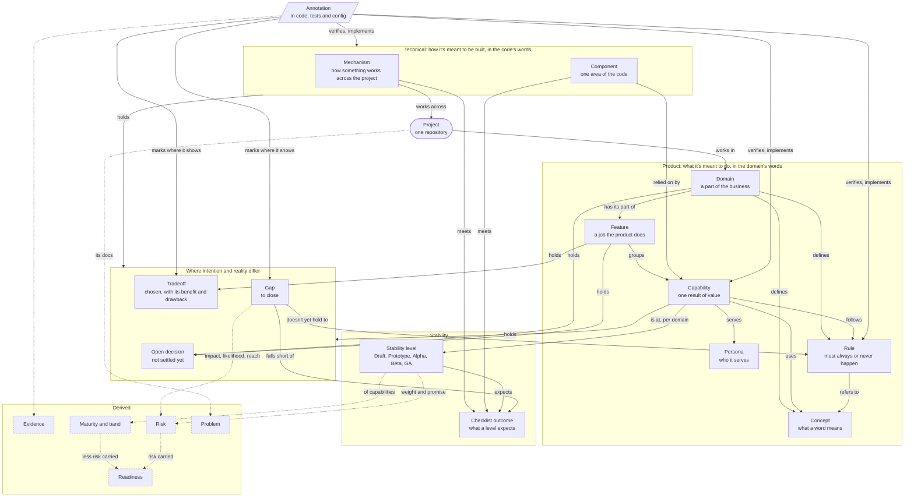

# Docket overview

What the words mean in Docket, and how they fit together. When a term here and
a word in the code, the spec or the UI disagree, the meaning here is the one we
intend, and the other one is wrong.

Each concept has a doc of its own in [`concepts/`](concepts/), with an example
of how it's written down. The [spec](../../spec/README.md) has the whole
format: file layout, frontmatter, IDs and the `state.json` schema. Examples
come from the spec's [examples](../../spec/examples/): a hotel's booking app
and its billing service.

## The big picture

A **[project](concepts/project.md)** is a place where software is defined in
**[docs](concepts/doc.md)**, and usually implemented, such as the hotel's
booking app: one repository. Projects that make up one product together, such
as the booking app and the billing service, are a
**[platform](concepts/platform.md)**, and Docket shows one platform at a
time. Each project works in one or more
**[domains](concepts/domain.md)**: parts of the business, each with its own
language, such as Guest stays or Billing. Every doc but a persona, a mechanism or
a component is written in exactly one domain. Every project contributes what it
knows to one picture of the whole product, and where two of them say different
things, Docket shows the **[contradiction](concepts/contradiction.md)** rather
than picking one.

A **[feature](concepts/feature.md)** is a job the product does, and it groups
the **[capabilities](concepts/capability.md)** that do that job. Features and
capabilities can span domains: each domain that does part of the work
contributes its part. Each capability has a
**[stability level](concepts/stability-level.md)** in each domain that builds
it, follows **[rules](concepts/rule.md)**, and uses
**[concepts](concepts/concept.md)**. Rules and concepts belong to a domain, and
mean what they say there. A capability refers to the ones it follows and uses,
so one rule can apply to many capabilities, in different features and domains.

A **[persona](concepts/persona.md)** is a type of person the software serves,
such as a front desk clerk. Each capability says which personas it serves, so
Docket can show, for each of them, what the software does for them and how
ready it is for them.

How the software is meant to be built is written down beside that, in the
code's words: **[mechanisms](concepts/mechanism.md)**, each how something
works across the whole project, and **[components](concepts/component.md)**,
each one area of the code. A component lists the capabilities that rely on it;
a mechanism applies to every capability its project, or its whole platform,
serves.

Intention and reality differ in a few named ways:
**[open decisions](concepts/open-decision.md)**, **[gaps](concepts/gap.md)**,
**[tradeoffs](concepts/tradeoff.md)** and **[problems](concepts/problem.md)**.
Each is declared on the thing it's about, and shown everywhere it matters.
Everything else declared is taken to hold: a gap is how we say part of it
doesn't yet.

Anything in the repository can point at a rule, capability, mechanism or
component with an **[annotation](concepts/annotation.md)**, as evidence that it
verifies or implements it, or mark where a gap or tradeoff shows in the code.
The **[indexer](concepts/indexer.md)** reads all of it, and works out each
one's evidence and any problems. Readers work out each feature's, domain's,
project's and persona's **[maturity](concepts/maturity.md)**, how far along it
is, and
score gaps by **[risk](concepts/risk.md)**, from the impact, likelihood and
reach each declares, the level of each capability it's on, and whether it
breaks that level's promise. From levels and risk they work out
**[readiness](concepts/readiness.md)**: how ready people can rely on each
capability, feature, domain, project and persona being, as a recommendation,
with what's left. It's maturity less the risk their gaps carry.

Solid arrows are [declared](concepts/declared-and-derived.md): written in a
doc, or given by the folder it's in. Dashed arrows and boxes are derived from
them, and nobody writes them by hand. An arrow into a group means some of
what's in it: [which each one holds](#where-intention-and-reality-differ) is
set out below.

## Agnostic of implementation

Domains, features and capabilities say what value the software provides, never
how it's built or delivered. A capability is the same capability whether
people use it through a web page, a mobile app, an API or a command line,
whether it runs as one service or ten, and whatever language, framework or
vendor is behind it.

- **They're described in the domain's words.** Their names, summaries and what
  they cover name no screens, buttons, endpoints, services, tables,
  functions, technologies or vendors. "Clerks book a room for a guest's stay",
  not "clerks submit the booking form" or "the bookings API creates a
  reservation".
- **Changing the implementation doesn't change them.** A rewrite, a new
  framework, splitting or merging services, or moving to another vendor never
  creates, removes, renames or splits a domain, feature or capability. If the
  software produces the same results of value afterwards, they're the same
  ones.
- **Delivery isn't a capability.** Offering room booking through an app as
  well as the web is another way to reach the same result, so it's part of
  room booking. It becomes a capability of its own only if it produces a result
  of value that wasn't possible before.
- **Implementation and value don't line up one to one.** One capability can be
  built from code in several places, and one piece of code can serve several
  capabilities.

A capability names no code. How it's built, and what we
intend about that, is in [technical docs](#how-its-built), which link to the
capabilities they serve and never the other way.

## How it's built

How the software is built, written for the engineer or agent about to change
it, in [mechanisms](concepts/mechanism.md) and [components](concepts/component.md).
Product docs say what the software does, in the domain's words, and never name
its implementation. Technical docs say how it's built, in the code's words,
and what we intend about that: the choices we made on purpose, what isn't done
yet, and what will surprise whoever changes it next. That's technical
intention, and the code can't show it.

They hold only what a competent reader couldn't learn from the code in a few
minutes. Most code needs none. A list of endpoints, tables or functions is
left out, since the code already says it.

- **They link to the capabilities they serve**, never the other way, so
  product docs stay the same whatever the implementation. A component lists
  them; a mechanism applies to every capability its project, or its platform,
  serves.
- **They have no stability level.** One can serve capabilities at different
  levels, so a level always names its capability.
- **They're in no domain.** They're written in the code's words, not a
  domain's.
- **They're one across every project by ID**, as features are. A mechanism that
  spans repositories has its whole picture in the one that owns it.

## Where intention and reality differ

Docket names the ways the software can differ from what's intended, so each
can be shown the same way and nothing is hidden:

| Shape | What it means | Declared or derived |
| --- | --- | --- |
| **[Open decision](concepts/open-decision.md)** | What's intended isn't settled yet | Declared |
| **[Gap](concepts/gap.md)** | The software falls short of what's intended, in a way that needs work nobody has done yet | Declared |
| **[Tradeoff](concepts/tradeoff.md)** | We chose this on purpose, with its benefit and drawback | Declared |
| **[Problem](concepts/problem.md)** | The docs are wrong or contradict each other | Derived |

Each declared one is written on the thing it's about, once, and shown on
everything it affects. When one seems to belong to two things, it's about
something they share, such as a rule they follow or a mechanism they rely on.
Nothing is declared on a project or a persona: theirs are worked out.

| Declared on | Open decisions | Gaps | Tradeoffs |
| --- | --- | --- | --- |
| Domain | Ones whose answer becomes a rule or concept | — | — |
| Feature | Ones whose answer adds a capability or rules one out | — | Non-goals: capabilities we've decided never to build |
| Capability | Ones whose answer changes what it does | What people using it would notice | Limits it has by choice |
| Mechanism or component | Ones whose answer becomes a tradeoff, a gap, or a mechanism or component | What only someone working on the code would notice | Technical choices |

A rule holds none of them. A rule is decided once its doc exists, and a gap
that says a capability doesn't hold to a rule yet is the capability's.

### What's left, and what holds

What's left is the open decisions and the gaps, and nothing else. Everything
declared, such as what a capability does, each rule it follows, and each
checklist outcome its level expects, is a claim, and each claim is in one of
three standings:

| Standing | When |
| --- | --- |
| **Not held** | A gap names it, for all of it or a part |
| **Not held, by choice** | A tradeoff names it: only a checklist outcome |
| **Held, with evidence** | Something in the repository points at it as [evidence](concepts/evidence.md) |
| **Held, on trust** | Nothing names it, which is the usual case |

A gap wins over a tradeoff, and both win over evidence. Evidence is always optional: it shows how we know
something holds, and its absence is never something left to do. A draft
capability claims nothing yet.

## Feature, capability or neither?

Ask what value the work adds:

| The work                                                              | Is                                                                     |
| --------------------------------------------------------------------- | ---------------------------------------------------------------------- |
| Gives the software a job it didn't do at all                          | A new feature, with the capabilities that start doing it               |
| Produces a new result of value toward a job the software already does | A new capability of that feature, a draft until it's started           |
| Adds another way to reach a result a capability already produces      | Part of that capability                                                |
| Makes a capability better at what it does                             | A change to that capability, often closing one of its gaps             |
| Only changes how something is built                                   | Neither, though it may close a mechanism's or component's technical gap   |

A rough check: the reason someone uses part of the software is a feature.
What they get done while they're there is a capability. The parts of the
business whose language they're in are its domains.

Some things are never features or capabilities:

- **A step or action**, such as picking dates or seeing which rooms are free,
  is part of a capability, unless it produces a result of value by itself.
- **A screen, page, endpoint or service** is how a capability is delivered,
  not what it is.
- **A rule** is a constraint capabilities do their jobs under: something that
  must always be true, or must never happen.
- **A quality**, such as being fast, accessible or secure, is how well
  capabilities do their job. Where one falls short, that's a gap in the
  capability.

## Every concept

**The product**

- [Platform](concepts/platform.md): the projects that make up one product,
  shown together.
- [Project](concepts/project.md): where software is defined, one repository.
- [Contradiction](concepts/contradiction.md): two projects saying different
  things that should agree.
- [Domain](concepts/domain.md): a part of the business, with a language of its
  own.
- [Feature](concepts/feature.md): a job the software does.
- [Capability](concepts/capability.md): the software's ability to produce one
  result of value.
- [Rule](concepts/rule.md): what must always be true, or must never happen.
- [Concept](concepts/concept.md): what a word means in a domain.
- [Persona](concepts/persona.md): a type of person the software serves.

**How it's built**

- [Mechanism](concepts/mechanism.md): how something works across a whole
  project.
- [Component](concepts/component.md): one area of the code.

**Where intention and reality differ**

- [Open decision](concepts/open-decision.md): a question not settled yet.
- [Gap](concepts/gap.md): something we intend to close.
- [Tradeoff](concepts/tradeoff.md): something we chose, knowing its benefit and drawback.
- [Risk](concepts/risk.md): what's at stake in a gap, scored from its impact,
  the level of each capability it's on, and whether it breaks that level's
  promise, and its exposure, how that spreads across them; and the risk
  carried by some capabilities, what their open gaps put at stake.

**Stability, maturity and readiness**

- [Stability level](concepts/stability-level.md): how much people can depend
  on a capability.
- [Stability checklist](concepts/stability-checklist.md): what each level
  generally expects.
- [Maturity](concepts/maturity.md): how far along a feature, domain, project,
  or what serves a persona, is.
- [Band](concepts/band.md): the quarter of the maturity scale something is in.
- [Readiness](concepts/readiness.md): how ready people can rely on the
  software being, as a recommendation, with what it still needs.

**Evidence**

- [Evidence](concepts/evidence.md): places that verify or implement something.
- [Annotation](concepts/annotation.md): the comment that makes a place
  evidence, or marks a gap or tradeoff.

**Docket itself**

- [Doc](concepts/doc.md): one Markdown file describing one thing.
- [Link](concepts/link.md): a relationship, written once, in one direction.
- [Declared and derived](concepts/declared-and-derived.md): what people write,
  and what's worked out.
- [Indexer](concepts/indexer.md): the program that works out the state.
- [State](concepts/state.md): a snapshot of a project at one commit.
- [Problem](concepts/problem.md): something wrong in the docs.
