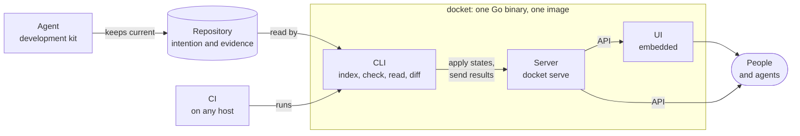

# Docket's parts

_Docket is planned as three parts: the format, the agent kit, and `docket`,
one Go program that does everything else. [Where it is today](#where-it-is-today)
says what's built._

**Contents:** [Overview](#overview) · [Agent development kit](#agent-development-kit) · [Format](#format) · [`docket`](#docket) · [Where it is today](#where-it-is-today) · [Open questions](#open-questions)

## Overview

Agents use the **kit** to keep a repository's intention and evidence current
as they build. The **`docket` CLI** reads the repository, on a laptop or in
CI, and sends each commit's state and its test results to the **server**,
which combines every project's state and shows it to everyone with a stake in
the software. The CLI and the server are the same program.

## Agent development kit

Tooling, skills and rules that let agents understand a project through
Docket, and take part in applying software engineering discipline to it:
reading a capability's level and rules before changing it, writing docs and
annotations in the same change as the code, and recording gaps and decisions
as they're made.

It's optional. Docket works without agents, and the kit is how they make the
most of it. It's written for any agent, as an `AGENTS.md` block and an Agent
Skills skill, and each project adds its own instructions beside it. Agents do
the work through the `docket` command, so the kit tells them which command
answers each question, rather than how to answer it by hand. `docket kit`
installs it into a project and keeps it up to date. See [`kit/`](../kit/).

## Format

_A better name will come._ The format is how a repository declares the state
of its software, in docs, frontmatter and annotations, and the shape of the
state worked out from it. It's defined by Docket's own concept docs, starting
from the [Authoring](../docket/domains/authoring/domain.md) domain. The
[stability rubric](../internal/rubric/rubric.yml), which says what each
stability level means, is built into `docket`. The format belongs to no one
tool: `docket` is one program that reads it, and anyone can write another.

## `docket`

One Go program that owns all of Docket's logic, shipped as a single binary
and a single container image. The same binary is the CLI, the server, and
what serves the UI.

- **Go owns everything Docket works out.** Indexing, checking, combining
  projects, maturity, readiness, risk and exposure, and how things changed
  between commits are each written once. The CLI, the server and the UI can
  never disagree.
- **As a CLI**, engineers, agents and CI use it to index and check a
  repository's docs, ask what a change touches, list gaps, see how something
  has changed, and send states and test and QA results to the server. It
  works on any repository host and in any CI. Every read can come from the
  working tree, a commit or the server. Its commands are drafted in
  [`cmd/docket/`](../cmd/docket/).
- **As the server**, with `docket serve`, it's where projects come together.
  It holds each project's applied state at every commit on its main branch,
  with the results sent for each, and combines projects into one view of the
  product, showing contradictions between them. It offers an API for the UI,
  agents and other tools, and serves the UI. Each client gets a server of
  their own, kept in SQLite. It has no sign-in yet, so a server holding a
  client's real projects must only be reachable by that client's people.
- **As a local viewer**, with `docket ui`, it serves the same UI over a
  repository's working tree, so anyone can see their branch the way the
  server will show it. It's only reachable from the machine it runs on.
- **The UI only shows things.** It gets everything from the API, derived
  figures included, and works nothing out itself.
- **One image runs it all.** It runs `docket serve` unless told to run
  another command, so the same image deploys the server and runs
  `docket apply` in CI. The binary is also released on its own.

The CLI reconciles each project with the server, much as infrastructure as
code does:

- **Preview** shows what merging a branch would change on the server:
  capabilities added or promoted, gaps closed, decisions answered, rules with
  new evidence, new problems.
- **Apply** sends each new commit on the main branch, so the server reflects
  the repository.

The repository owns intention, and the server owns what was observed. The
server is never edited directly, and its history can always be rebuilt from
git.

[How `docket` is built](architecture/) plans its code: where its logic
lives, how the CLI and the server share it, and the API the UI reads.

## Where it is today

| Part                  | Today                                                                                                                                                                                                                                                                                                                                                                       |
| --------------------- | --------------------------------------------------------------------------------------------------------------------------------------------------------------------------------------------------------------------------------------------------------------------------------------------------------------------------------------------------------------------------- |
| Format                | A draft for review, defined by Docket's concept docs, starting from the [Authoring](../docket/domains/authoring/domain.md) domain, with example projects in [`examples/`](../examples/).                                                                                                                                                                                     |
| `docket`              | Sets up a project and installs the kit, indexes and checks it, answers what a change touches, shows and lists its docs, the rubric and what's changed, renames IDs, and applies its states to the server, which keeps them in SQLite. The rest of the commands drafted in [`cmd/docket/`](../cmd/docket/) exist with their flags, and say they aren't built yet. The examples' `state.json` files are written by hand. |
| UI                    | An early UI in TypeScript that reads only the server's API. See [`ui/`](../ui/).                                                                                                                                                                                                                                                                                            |
| Agent development kit | For any agent: an `AGENTS.md` block and a `docket` skill, installed with `docket kit`, and used to build Docket itself. Every command it names is built, over the working tree or a commit, but none reads the rest of the product or the server yet. See [`kit/`](../kit/).                                                                                                 |

## Open questions

What we haven't decided is written down as open decisions in Docket's own
docs, on the domain or capability each is about, such as
[what to call the format](../docket/domains/authoring/capabilities/docs-format.md)
and [how people sign in to a server](../docket/domains/reporting/capabilities/applying.md).
`docket check` at the root of this repository indexes them, and the UI shows
them.
